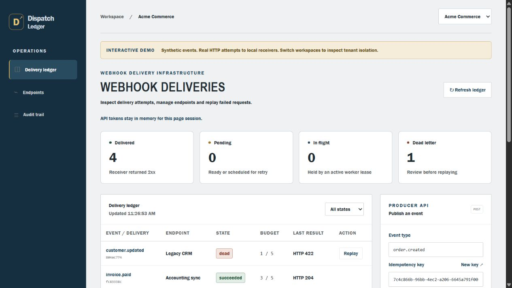
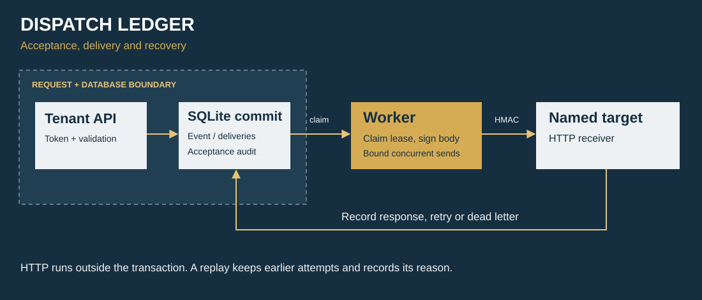

# Dispatch Ledger

A tenant-isolated event delivery service with transactional fanout, signed HTTP attempts, bounded retries, and an operations console.

TypeScript · Node.js · SQL · Browser JavaScript

[](https://github.com/ismaeelakin/dispatch-ledger/actions/workflows/ci.yml)



## The problem

A producer submits an event, a receiver goes offline, and a retry arrives after the original request already succeeded. Now the system needs to answer four questions: **what was accepted, who may access it, what was actually attempted, and what is safe to replay?**

Dispatch Ledger makes those boundaries visible. Event acceptance and delivery creation commit together. Every request is scoped to a tenant. Attempts carry a signature and a stable delivery ID. Dead-letter replay requires a reason and retains the original attempt history.

## Tech stack

TypeScript, Node.js 22.16+, node:sqlite, SQL and browser JavaScript. No third-party runtime dependencies.

## Run the complete demo

Requires **Node.js 22.16+** and npm. There are no third-party runtime dependencies. The Node 22 `node:sqlite` API is experimental; this project deliberately keeps its storage adapter small and tests against both Node 22 and 24.

```sh
git clone https://github.com/ismaeelakin/dispatch-ledger.git
cd dispatch-ledger
npm ci
npm run demo
```

Open **http://127.0.0.1:8080**. The demo starts the API, a bounded delivery worker, and three local HTTP receivers. It uses synthetic data and a temporary database/key; no external webhook is contacted. Stop with Ctrl+C to clean up.

| Try this                   | What actually happens                                                                                              |
| -------------------------- | ------------------------------------------------------------------------------------------------------------------ |
| Inspect `invoice.paid`     | The receiver returns 503 twice, then 204. Select the event to inspect all three attempts.                          |
| Inspect `customer.updated` | A 422 response sends the delivery straight to dead letter. Replay preserves history and records your reason.       |
| Publish `order.created`    | The event and its subscribed delivery records commit atomically. The worker signs and sends the real HTTP request. |
| Publish the same key again | The original event is returned, with no duplicate fanout. Changed content returns 409.                             |
| Switch to Northstar Labs   | A different bearer token loads a different tenant's endpoints, deliveries and audit records.                       |
| Pause an endpoint          | Future claims stop. In-flight requests are not recalled.                                                           |

The demo credentials are intentionally public, work only in the demo's temporary database, and are not production credentials.

## Architecture



## Guarantees and boundaries

- **Atomic acceptance:** an event, its subscribed delivery records, and its acceptance audit entry commit in one SQLite write transaction.
- **Tenant isolation:** bearer tokens are stored as SHA-256 hashes. Tenant predicates protect reads and mutations; composite foreign keys reject cross-tenant links in storage.
- **Secret handling:** endpoint secrets are encrypted with AES-256-GCM using tenant/endpoint identity as authenticated context. Registration returns the signing secret once; list responses omit it.
- **Accountable delivery:** fresh lease tokens fence stale workers. Every completed or expired attempt has a durable result. Worker requests happen outside database transactions.
- **Receiver verification:** HMAC-SHA256 binds timestamp, delivery ID and exact body bytes. The supplied verification helper checks a five-minute timestamp window using constant-time comparison.
- **Controlled recovery:** retryable network/timeout/408/425/429/5xx results use capped exponential backoff and deterministic jitter. Permanent failures and exhausted budgets go to dead letter.
- **Restricted egress:** tenants choose named, operator-configured targets, never arbitrary URLs. Redirects are not followed; requests have a timeout and response bodies are discarded.

Delivery is **at least once**, not exactly once. A receiver may commit work and lose its response. It must deduplicate the stable delivery ID atomically with its business side effect. The demo's persistent inbox illustrates duplicate suppression; it does not make arbitrary third-party side effects atomic.

This release is a **single-host engineering implementation** with a loopback-bound console/API. It does not claim multi-region operation, production traffic, or a hardened public deployment. See the [threat model](docs/THREAT_MODEL.md) and [architecture decisions](docs/ARCHITECTURE.md).

## Service mode

Keep a stable master key outside the database. Generate it once and retain it securely; losing it makes existing signing secrets unreadable.

```sh
npm run build
# Set environment variables using your shell or secret manager:
# DISPATCH_MASTER_KEY = 64 lowercase hex characters (32 random bytes)
# DISPATCH_TARGETS = [{"id":"billing","url":"https://your-receiver.example/hooks"}]
# DISPATCH_DB = data/dispatch.db
npm run provision -- "Example tenant"
npm start
```

The provisioning command prints a newly generated tenant token once. The console accepts it in memory for the current page session; it is never saved to localStorage or embedded in a URL. See [.env.example](.env.example) for variable names. Environment files are not loaded automatically.

Create an endpoint with its configured target ID, configure the returned signing secret in your receiver, then publish events using `Authorization: Bearer ...` and an `Idempotency-Key` header. The [API guide](docs/API.md) and [OpenAPI description](docs/openapi.json) give the request contracts.

## Verify

```sh
npm ci
npm run format:check
npm run check
npm test
```

The suite includes real localhost HTTP deliveries, separate competing worker processes, cross-tenant authorization, database foreign-key rejection, injected transaction failure, restart persistence, signature tampering and replay-window checks, encryption context binding, retries, dead-letter replay history, pagination, rate limits, response-time bounds, and graceful worker shutdown. Database time tests use an injected clock rather than sleeps.

CI runs the same checks on Linux and Windows with Node 22 and 24. There are no API keys, external accounts, paid services or broker containers required to run the suite.

## Read the engineering

| Review area                            | Start here                                                               |
| -------------------------------------- | ------------------------------------------------------------------------ |
| Transactional outbox and lease fencing | [Store](src/store.ts) · [SQL constraints](migrations/001_initial.sql)    |
| Signed requests and bounded transport  | [Transport](src/transport.ts) · [Cryptographic helpers](src/domain.ts)   |
| Tenant and request boundaries          | [HTTP adapter](src/server.ts) · [Request-level tests](test/http.test.ts) |
| Worker concurrency and shutdown        | [Worker](src/worker.ts) · [Integration tests](test/worker.test.ts)       |
| Recovery tradeoffs and scaling path    | [Architecture](docs/ARCHITECTURE.md) · [Operations](docs/OPERATIONS.md)  |

The interesting work is in the contracts and failure handling. The console is a way to inspect those contracts. It runs against the same API as other clients.
