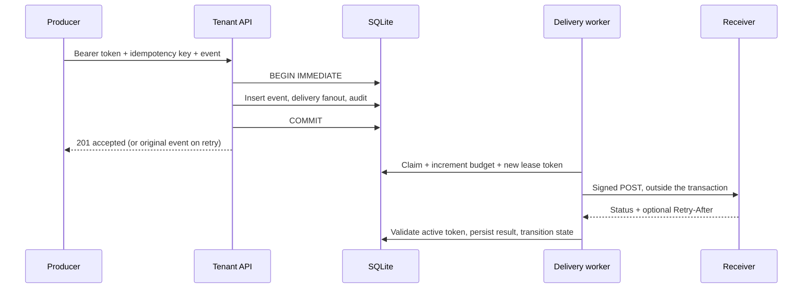

# Architecture and decisions

## Data flow

The `deliveries` table is the outbox. There is no separate broker and no dual write to a database plus queue. A deliberately injected delivery-insert failure tests that both the event and acceptance audit record roll back.

## Why SQLite

WAL, full synchronization, foreign keys, short write transactions and no extra service make the system easy to run and inspect. The tradeoff is one writer at a time. `DatabaseSync` operations block Node's event loop while they execute or wait for a lock; the busy timeout is five seconds. This is a real scaling limit, not a distributed queue.

Migrations acquire a write lock and recheck the schema version after waiting, so simultaneous initializers do not run the same migration twice. Only schema version 1 is supported. Upgrades need new, tested forward migrations; the code never drops unknown schemas.

## Tenancy is a data invariant

The authentication lookup returns a tenant ID from the hash of a random API token. The API never accepts a tenant ID in event or endpoint bodies. Every resource query and mutation includes the authenticated tenant ID. Composite foreign keys bind deliveries to both their event and endpoint within the same tenant, and attempt history to its delivery and tenant.

The worker and provisioning CLI are privileged components: they must see multiple tenants to operate. Tenant API credentials cannot call those internal methods. There is one capability level per tenant in v0.1; there is no per-user RBAC, SSO or delegated operator role.

## Event identity and fanout

The fingerprint covers event type and canonical JSON data; an idempotency key is unique within a tenant. Object keys are sorted recursively, and depth and encoded size are bounded. The wire body is stored once and remains byte-for-byte stable across delivery attempts.

The first accepted event snapshots active matching subscriptions. Replaying the same producer request does not fan out to endpoints added later. An event with no matching endpoint is accepted with zero deliveries. These semantics avoid silently changing the meaning of an already accepted request.

## Lease and attempt model

States are `pending`, `in_flight`, `succeeded`, and `dead`. A claim increments both the current retry-budget counter and a lifetime sequence number, then stores a fresh token and 15-second deadline. Database time is sampled after obtaining the write lock.

Requests have a three-second timeout. Up to four are active per worker process by default. A token and unexpired lease are required to finish a delivery. An expired worker result is ignored. The next claim records expired attempts as `worker_lost` and either requeues or dead-letters them. Current budget is five claims, including lost workers.

Explicit retry delay is capped exponential backoff with deterministic jitter, optionally increased by a delta-seconds `Retry-After` value, capped at 300 seconds. HTTP-date Retry-After is deliberately unsupported. Lease-expiry recovery adds no extra backoff. There is no heartbeat or long-running request support.

Manual replay resets only the current budget. Lifetime attempt sequence and all existing attempt rows remain. A required operator reason creates an audit record. Endpoint disablement prevents new claims; an already-sent request may still finish.

## Delivery semantics

Leases prevent stale workers from changing queue state, not from contacting a receiver. A worker can send successfully and die before recording the result. An acknowledgment can also be lost. Duplicates are therefore part of the protocol. Use the stable delivery ID as the receiver inbox key and commit that key with the receiver's side effect in its own transaction.

There is no FIFO guarantee across endpoints, no ordering guarantee across concurrent workers, no tenant fairness guarantee, and no exactly-once side-effect claim.

## Scaling path

The next architecture should follow measured constraints. Move to PostgreSQL and `FOR UPDATE SKIP LOCKED` when write contention dominates; add authenticated tenant/user roles when team operations require them; add per-endpoint concurrency and circuit breakers when noisy receivers dominate. Retention, metrics, key rotation and a hardened public server adapter are separate work items, not implied by adding replicas.
